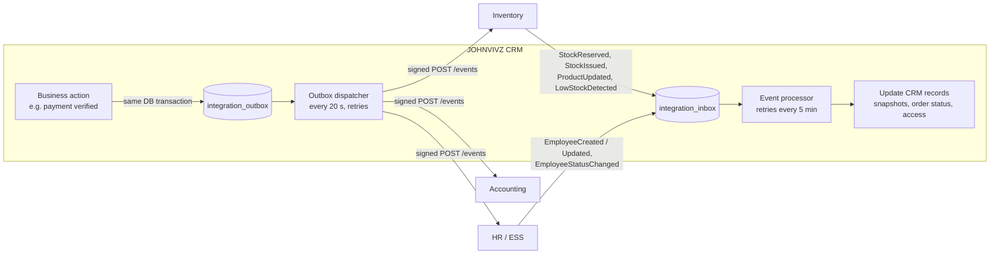
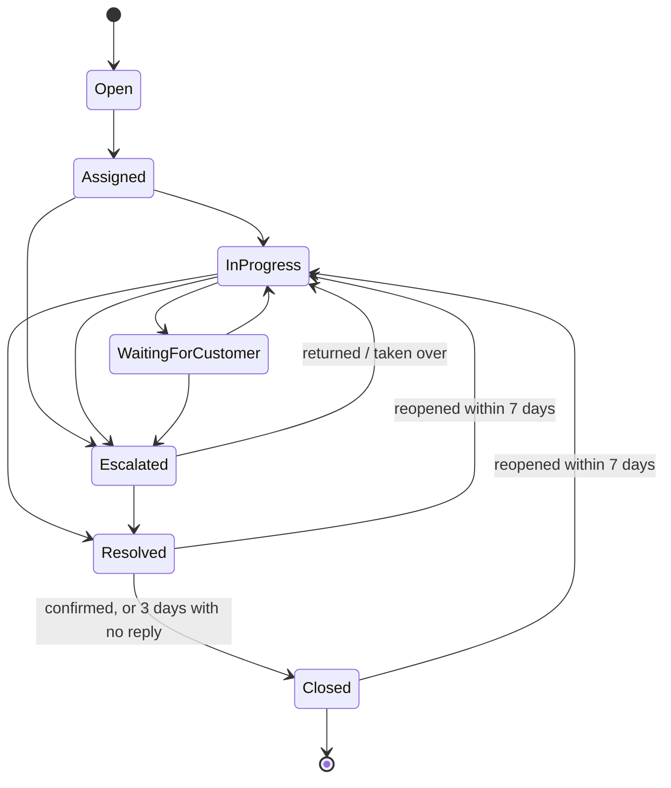

# JOHNVIVZ CRM

**Customer Relationship Management for the JOHNVIVZ ecosystem: an event-driven Node.js application**

JOHNVIVZ CRM is one of four JOHNVIVZ applications: **HR**, **Accounting & Payroll**, **CRM** and **Inventory**. Each app owns its own database. The apps never read each other's tables. They work together only through **signed REST calls and domain events** (`SaleCompleted`, `StockIssued`, `EmployeeStatusChanged`, …), which go through a transactional **outbox** and an idempotent **inbox**.

The CRM handles customers, inquiries, support cases with escalation and SLAs, sales orders, payments, refunds, loyalty, campaigns and analytics. Every user (Manager, Team Leader, Agent, Customer and Setup Admin) gets their own pages and sees only the data their role allows.

> Developer: **Ralph Kenneth Egina**, BSIT 3-F1 · Final Project: Event-Driven Programming

---

## Contents
1. [Tech stack](#tech-stack)
2. [Event-driven architecture](#event-driven-architecture)
3. [Features](#features)
4. [Getting started](#getting-started)
5. [Demo accounts](#demo-accounts)
6. [Roles and access](#roles-and-access)
7. [Case lifecycle](#case-lifecycle)
8. [Commands](#commands)
9. [Testing](#testing)
10. [Project structure](#project-structure)
11. [Documentation](#documentation)
12. [Project status](#project-status)

---

## Tech stack
| Layer | Technology |
|---|---|
| Runtime | Node.js (ES modules) |
| Framework | [XianFire Framework](bin/xian.js): Express 4 with `.xian` Handlebars views |
| Database | MySQL (Laragon or XAMPP), Sequelize 6 plus plain-SQL migrations; database `johnvivz_crm_db` |
| Styling | Tailwind CSS |
| Auth | `express-session`, bcrypt, CSRF protection, email verification and password reset (Nodemailer) |
| Exports | ExcelJS (`.xlsx`) and PDFKit (`.pdf`) |
| Integration | HMAC-SHA256 signed HTTP, outbox and inbox tables, background jobs |

---

## Event-driven architecture



**How it works**
- **Transactional outbox:** when something important happens (an order confirmed, a sale completed or cancelled, a refund recorded), CRM writes the event to `integration_outbox` in the *same database transaction* as the change. If the change is saved, the event is saved too.
- **Dispatcher with retries:** a background job sends pending events every 20 seconds. A failed send is retried after +1 min, +5 min, +15 min, +1 h and +6 h. After the 6th failure the event goes to a **dead-letter queue**, which an admin can retry from *Integration Health*.
- **Idempotent inbox:** incoming events are stored first (`202 Accepted`) and processed afterwards. `event_id` and `(source, idempotency_key)` are both unique, so a duplicate event is acknowledged but never processed twice.
- **Signed messages:** every request in either direction carries `X-JVZ-Client`, `X-JVZ-Timestamp` and an HMAC-SHA256 `X-JVZ-Signature`. Requests with an old timestamp or a reused signature are refused.
- **Adapter modes:** each connected app runs in `disabled`, `mock` (the default; uses local fixtures and flags records `is_mock`) or `live` mode. CRM works on its own without the other three apps.
- **Data privacy:** CRM keeps only snapshots of employees and products. If an HR payload includes salary, bank or government ID fields, CRM removes them before storing anything.

**Events CRM publishes:** `OrderConfirmed`, `SaleCompleted`, `SaleCancelled`, `RefundRecorded`, and `EmployeeRequestDecided` (draft, behind a feature flag).
**Events CRM consumes:** `StockReserved`, `StockIssued`, `LowStockDetected`, `ProductCreated/Updated`, `ProductPriceUpdated`, `StockUpdated`, `EmployeeCreated/Updated`, `EmployeeStatusChanged`, `Department*`, `Position*`, and `EmployeeRequestSubmitted` (draft).

The full contract, with envelope, payloads and error codes, is in [docs/integration-contract.md](docs/integration-contract.md).

---

## Features
- **Customer master:** walk-in creation with a duplicate check, contacts, addresses, preferences and consent, an interactions timeline, and agent assignment. Numbering: `CUS-000001`.
- **Customer service:** inquiries (answer, or convert to a case), support cases (`JVT-YYYYMMDD-0001`), follow-up tasks with reminders, two escalation levels, SLA targets per priority with overdue alerts, ratings, reopen and auto-close.
- **Sales:** product catalog from Inventory, a cart and checkout that re-checks price and stock, stock reservation, payments with a second-person check, sales, refunds, promotions and discount codes, and order tracking for customers.
- **Loyalty and marketing:** 1 point per ₱100 spent, 100 points = ₱10, points reversed on refund; campaigns with results taken from real orders.
- **Dashboards and analytics:** a dashboard for each role built from live data, statistical forecasts labelled **Estimate**, rule-based customer segments, and reports exported to Excel or PDF.
- **Identity and security:** CRM access granted to HR employees with one-time set-password links, email verification, password reset, record scope enforced in every query, and an append-only audit log that also records denied attempts.
- **Integration Health:** inbox and outbox status, dead letters with manual retry, and sales reconciliation.
- **Customer portal:** profile, submitting complaints and inquiries, replying to cases, confirming or reopening them, rating the service, shopping and tracking orders.

---

## Getting started

### Requirements
- Node.js 18 or newer
- MySQL through **Laragon** (recommended) or **XAMPP**

### Install and run
```bash
git clone https://github.com/RalphEgina0219/FINAL_PROJECT_EVENTDRIVEN_EGINA.git
cd FINAL_PROJECT_EVENTDRIVEN_EGINA
npm install
cp .env.example .env        # Windows: copy .env.example .env
npm run migrate             # creates johnvivz_crm_db (if missing) and applies the migrations
npm run seed                # demo accounts and demo data (every row is_demo = 1)
npm start                   # http://localhost:3000
```

### Configure `.env`
- **`SESSION_SECRET`:** set it to a long random string.
- **Database:** the defaults match Laragon. For XAMPP, use `DB_USER=root` with an empty `DB_PASSWORD`.
- **Integration secrets:** `.env.example` ships with the `JVZ_SECRET_*`, `JVZ_CRM_INBOUND_SECRET_*` and `*_API_TOKEN` values empty on purpose. They are not needed in the default `mock` mode. To connect real apps, run `npm run secrets` and share each team's lines privately.
- **Email:** `MAIL_TRANSPORT=log` (the default) sends nothing; messages appear under *Setup › Mail Log*. Set `MAIL_TRANSPORT=smtp` and the `SMTP_*` values to send real email.

Never commit your `.env`. It is already in `.gitignore`.

---

## Demo accounts
All demo accounts use the password **`Demo@1234`**.

| Account | Role | Home page |
|---|---|---|
| `admin@johnvivz.test` | System Administrator (setup only, no customer data) | `/setup` |
| `manager@johnvivz.test` | CRM Manager | `/crm/manager` |
| `maria.santos@johnvivz.test` | Team Leader, Customer Care Team | `/crm/team-leader` |
| `kristine.bautista@johnvivz.test` | Agent, Customer Care Team | `/crm/agent` |
| `juan.cruz@johnvivz.test` | Customer | `/portal` |
| `ana.delarosa@johnvivz.test` | Customer | `/portal` |
| `liza.fernandez@johnvivz.test` | Customer | `/portal` |

The seed also creates 2 walk-in customers without a login, and 40 demo cases that cover every status, both escalation levels, ratings and one reopened case. Staff come from a clearly labelled **mock HR fixture** until the real HR app is connected. `npm run seed:clear` removes only the demo rows.

---

## Roles and access
| Role | Can do |
|---|---|
| **CRM Manager** | See all of CRM; assign cases to any agent; handle level-2 escalations; manage settings (rules and SLA, categories, templates, teams and CRM access); view the audit log; run reports and exports |
| **Team Leader** | See their team's cases and the queue of new cases; assign cases within the team; handle level-1 escalations and escalate to the Manager; run team reports |
| **Agent** | Work on assigned cases (reply, status, priority, category, internal notes); escalate to the Team Leader; see their own customers |
| **Customer** | Manage their profile; submit complaints and inquiries; reply to, confirm or reopen a case; rate the service; shop and track orders |
| **System Administrator** | Setup only: system settings and the mail log. Every action is audited |

- Permissions live in the `roles`, `permissions` and `role_permissions` tables, shown under *Manager › Settings › Roles & Permissions*.
- Record scope is checked on the server in every query, so hiding a button is never the only protection.
- When HR marks a staff member *inactive* or *separated*, that person loses access on their next request.

---

## Case lifecycle

- **Escalation:** Agent → Team Leader (level 1) → CRM Manager (level 2). Each step requires a reason.
- **Resolved** requires a resolution note, which is posted to the customer as a public comment.
- The status dropdown lists only the valid next statuses for the case and the user's role. The server checks every change again, and refused jumps are audited as `case_status_rejected`.

---

## Commands
| Command | What it does |
|---|---|
| `npm start` / `npm run dev` | Start the app (`dev` restarts on file changes with nodemon) |
| `npm run migrate` | Create the database and apply pending migrations |
| `npm run migrate:status` / `migrate:rollback` | List migrations / undo the last batch |
| `npm run seed` / `seed:clear` / `seed:reset` | Add, remove or reseed demo data (refuses to run when `NODE_ENV=production`) |
| `npm run route:list` | List every registered route |
| `npm run secrets` | Generate the integration secrets for every team (`--write` saves them in the git-ignored `merge-kit-secrets/`) |
| `npm run check:connections` | Check each connection to HR, Inventory and Accounting, and say OK or FAILED with the reason |
| `npm run fake:teammates` | Start fake HR, Inventory and Accounting servers that follow the contract, for local testing |
| `npm run db:backup` / `db:restore-test -- <file>` | Back up with mysqldump / test a restore into a throwaway database |
| `npm run first-accounts -- --setup-admin <email> --manager <HR ID>` | Production only: create the first admin and manager with one-time password links |
| `npm run docs:er` | Regenerate the [ER diagram](docs/ER-DIAGRAM.md) from the database |

---

## Testing
```bash
npm test             # all 13 acceptance suites
npm run test:p6      # one suite (test:p1 … test:p10, test:ui, test:status, test:dialects)
```
- Each suite runs against its own throwaway `_test` database, so your data is never touched.
- The integration suites (P6, P7, P10 and dialects) start local fake HR, Inventory and Accounting servers and exercise real signed HTTP calls, the outbox retries, inbox duplicates and dead letters.
- `node tests/support/screenshots.mjs` takes screenshots of every menu page at desktop and phone width (needs Chrome or Edge).

---

## Project structure
```
├── bin/                  XianFire CLI
├── config/               .env loading, defaults, production start-up checks
├── controllers/          Request handlers (cases, customers, sales, approvals, …)
├── helpers/              View helpers
├── jobs/                 Background jobs (outbox dispatcher, inbox retries, SLA, auto-close)
├── middleware/           Authentication, CSRF, rate limiting, security headers, uploads
├── migrations/           1xx_*.js schema migrations (plain MySQL DDL)
├── models/               Sequelize models
├── public/               CSS, images
├── routes/
│   ├── index.js          Web routes
│   └── integrationApi.js Signed machine-to-machine API under /api/integration/v1
├── scripts/              Merge kit and operations scripts
├── seeders/              Demo data
├── services/             Business rules (caseService, orderService, refundService, …)
│   └── integration/      Adapters, HMAC signing, outbox dispatcher, inbox, reconciliation, mock fixtures
├── storage/              Uploaded attachments (git-ignored)
├── tests/                Acceptance suites and fake teammate servers
├── views/                .xian templates
└── docs/                 Blueprint, integration contract, guides, ER diagram, phase reports
```

The database schema is created only by migrations; the app never calls `sequelize.sync()`.

---

## Documentation
| Document | Contents |
|---|---|
| [docs/johnvivz-blueprint.pdf](docs/johnvivz-blueprint.pdf) | The ecosystem blueprint (highest authority) |
| [docs/integration-contract.md](docs/integration-contract.md) | Event envelope, events, APIs, HMAC signing, error codes |
| [docs/MERGE-GUIDE.md](docs/MERGE-GUIDE.md) | Connecting CRM with the HR, Inventory and Accounting apps |
| [docs/MERGE-TEST-SCENARIOS.md](docs/MERGE-TEST-SCENARIOS.md) | End-to-end scenarios to run together with the other teams |
| [docs/DEPLOYMENT.md](docs/DEPLOYMENT.md) | Production deployment |
| [docs/ER-DIAGRAM.md](docs/ER-DIAGRAM.md) | Entity-relationship diagram |
| [docs/crm-alignment-report.md](docs/crm-alignment-report.md) | Plan, conflicts and decisions |
| [docs/phase-reports/](docs/phase-reports/) | One report per build phase |

---

## Project status
| Phase | Scope | Status |
|---|---|---|
| P1 | Foundation: database, migrations, roles, scopes, case flow, portal, audit, adapter framework | ✅ Done |
| P2 | Identity: CRM access, email verification, password reset | ✅ Done |
| P3 | Customer master | ✅ Done |
| P4 | Customer service: inquiries, follow-ups, staff-created cases | ✅ Done |
| P5 | Sales: checkout, reservation, payments, refunds, promotions, campaigns | ✅ Done |
| P6 | Integration: signed API, inbox, outbox with retries and dead letters, live adapters | ✅ Contract-tested against fake servers |
| P7 | ESS approvals queue (behind `APPROVALS_ENABLED=false`) | ✅ Draft, mock source only |
| P8 | My Requests, loyalty, campaign results, team targets | ✅ Done |
| P9 | Dashboards, analytics, forecasts, segments | ✅ Done |
| P10 | Final testing, merge kit, deployment guide, ER diagram | ✅ Done |

**Note:** the integration with the real HR, Inventory and Accounting apps is **contract-tested only**. It has passed against local fake servers built from the contract and has not yet been verified with the real apps. See the [merge test scenarios](docs/MERGE-TEST-SCENARIOS.md).
